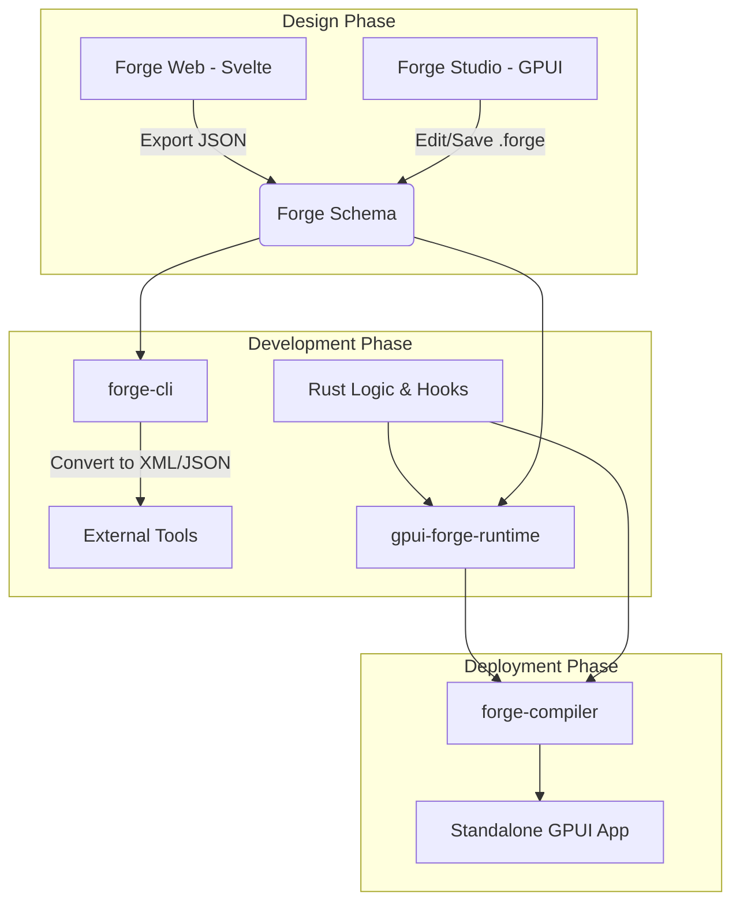

# GPUI Forge

**GPUI Forge** is an integrated ecosystem of tools designed to bring visual prototyping and rapid UI development to the [GPUI](https://www.gpui.rs/) framework. 

The goal of this project is to bridge the gap between high-level design and low-level Rust implementation, allowing developers to visually compose complex, high-performance user interfaces that can be seamlessly compiled into standalone, production-ready GPUI applications.

## 🚀 The Vision
Traditional GPUI development requires writing imperative Rust code for every layout and element. **GPUI Forge** introduces a declarative workflow: design your interface visually in a desktop or web-based editor, define logic via hooks, and compile the result into a high-performance native binary.

---

## 🛠 The Ecosystem

The project is comprised of six core pillars that work in tandem:

### 1. The Forge Schema (`forge-spec`)
A multi-format specification for defining GPUI element trees. To ensure interoperability, we support:
*   **Forge YAML:** Plain YAML with a JSON Schema: human-readable, one fact per line for clean Git diffs, and editable with existing YAML tooling.
*   **JSON/XML:** Standardized formats for machine-to-machine communication between the Web Builder and the Rust Engine.

See the draft [Forge YAML format](docs/spec/forge-yaml.md) and [document model](docs/spec/document-model.md).

### 2. The Forge Converter (`forge-cli`)
A powerful command-line utility used to transform interface definitions between all supported formats (e.g., converting a JSON blob from the web editor into a `.forge` file for the desktop editor).

### 3. The Forge Runtime (`gpui-forge-runtime`)
The core Rust library that powers everything else. It is responsible for:
*   Parsing Forge definition files at runtime.
*   Mapping declarative elements (Buttons, Containers, Text) to native components from the project's [base component system](#-base-component-systems) ([gpui-kit](https://github.com/longbridge/gpui-kit) by default).
*   **The Hook System:** A reactive bridge that allows developers to inject custom Rust logic and event handlers into the visually defined UI structure.

### 4. The Forge Studio (`forge-studio`)
The flagship desktop application built natively using **GPUI**. Inspired by [Workbench](https://github.com/workbenchdev/Workbench), it provides a professional IDE experience:
*   A visual canvas for dragging and dropping components.
*   Property inspectors for layout, styling, and padding.
*   Real-time preview of the UI logic. Studio itself is built with gpui-kit; projects on other bases are rendered by a separate preview process for that base (`forge-preview-<base>`), which Studio controls over IPC.

### 5. The Forge Compiler (`forge-compiler`)
A build tool that takes a `.forge` definition and a set of Rust "hooks" and bundles them into a standalone, optimized GPUI application. This allows you to ship "demos" or "prototypes" as complete, single-binary executables.

### 6. Forge Web (`forge-web`)
A lightweight, Svelte-based web application that brings the power of visual design to the browser. The Svelte shell hosts a canvas that renders the real components of the project's base via `gpui-forge-runtime` compiled to WebAssembly (one canvas bundle per WASM-capable base), so web and native output match. It serves as a collaborative design tool, allowing designers to iterate on UI layouts and export JSON definitions that can be immediately pulled into the Rust workflow.

---

## 🧩 Base Component Systems

A Rust app links exactly one `gpui`, so components built on different GPUI versions or forks can't be mixed in one window. Each Forge project therefore picks a **base** when it is created (`base:` in `forge.toml`). The base fixes the GPUI build, and Forge only offers libraries that are compatible with it. Within a base you can mix and match libraries freely.

| Base | GPUI build | Base library | Compatible add-ons | Web/WASM |
|---|---|---|---|---|
| **gpui-kit** (default) | `gpui-pre =0.3.9` | [gpui-kit](https://github.com/longbridge/gpui-kit) | [Ely GPUI Component](https://github.com/ELY-Open-Source/Ely-GPUI-Components), [gpui-video-player](https://github.com/cijiugechu/gpui-video-player), [zorite](https://github.com/packetThrower/zorite) widgets (GPL-3.0, opt-in), HIG for GPUI (after bump) | yes |
| **Bezel** | `bezel-gpui 0.3.x` (fork) | [Bezel](https://github.com/crabtalk/bezel) | Bezel ecosystem (chart, editor, canvas, markdown, terminal, icons, motion, …) | yes |
| **adabraka-ui** | `adabraka-gpui 0.5` (fork) | [adabraka-ui](https://github.com/Augani/adabraka-ui) | none known | no (nightly Rust) |
| **Vanilla GPUI 0.2** | crates.io `gpui 0.2.2` | [guise](https://github.com/wess/guise) | [ferrum-flow](https://github.com/tu6ge/ferrum-flow), [gpui-symbols](https://github.com/AprilNEA/gpui-symbols), [rhythm-gpui](https://github.com/P233/rhythm-gpui), gpui-video-player, … | no |

*   Each library ships a catalog manifest declaring the bases it supports; validation rejects incompatible libraries.
*   The runtime is compiled once per base, and the compiler emits a `Cargo.toml` + `rust-toolchain` for the chosen base.
*   Changing base later is a migration (`forge migrate --base`).
*   Libraries pinned to raw Zed git revisions fit no base and are tracked for porting ([#83](https://github.com/skamansam/gpui-forge/issues/83)).

### Non-GPUI bases (planned)

Bases are not limited to GPUI builds. The document model, Forge YAML loader, catalogs and
validation are toolkit-agnostic, so the same files drive other UI frameworks. What each
non-GPUI base needs is a catalog, a runtime adapter, its own style profile (the style &
layout keys map to GPUI `Styled` methods) and a preview host (`forge-preview-<base>`,
[#97](https://github.com/skamansam/gpui-forge/issues/97)).

| Base | Kind | Event model | Web/WASM | Tracking |
|---|---|---|---|---|
| **ratatui** | Terminal UI; immediate-mode, drawn from state each frame | `on <event>` fires while the node is focused (key/mouse are polled) | via a terminal-emulator backend (e.g. ratzilla) | [#112](https://github.com/skamansam/gpui-forge/issues/112) |
| **iced** | Elm-style GUI on winit/wgpu — not a TUI | `on <event>` maps to a `Message` in `update()` | experimental | [#113](https://github.com/skamansam/gpui-forge/issues/113) |

---

## 📐 Architecture Overview



---

## 🛠 Tech Stack

*   **Language:** [Rust](https://www.rust-lang.org/) (Core engine, Runtime, Studio, Compiler)
*   **UI Framework:** [GPUI](https://www.gpui.rs/)
*   **Components:** a per-project [base component system](#-base-component-systems): gpui-kit (default), Bezel, adabraka-ui or Vanilla GPUI 0.2
*   **Web Frontend:** [Svelte](https://svelte.dev/) shell + the base's canvas compiled to WebAssembly
*   **Serialization:** `serde` (JSON/XML/Custom)

## 🗺 Roadmap

- [ ] **Phase 1: The Foundation.** Define the `.forge` specification ([#1](https://github.com/skamansam/gpui-forge/issues/1)) and implement the `gpui-forge-runtime` ([#12](https://github.com/skamansam/gpui-forge/issues/12)), plus base component systems and library adapters ([#70](https://github.com/skamansam/gpui-forge/issues/70)) — GPUI bases first, then non-GPUI bases like ratatui and iced ([#112](https://github.com/skamansam/gpui-forge/issues/112), [#113](https://github.com/skamansam/gpui-forge/issues/113)).
- [ ] **Phase 2: The CLI.** Build `forge-cli` for format conversion ([#22](https://github.com/skamansam/gpui-forge/issues/22)).
- [ ] **Phase 3: The Web Canvas.** Create the Svelte editor for basic layout composition ([#29](https://github.com/skamansam/gpui-forge/issues/29)).
- [ ] **Phase 4: The Studio.** Develop the native GPUI desktop IDE (Forge Studio) ([#41](https://github.com/skamansam/gpui-forge/issues/41)).
- [ ] **Phase 5: The Bridge.** Finalize the Hook system to connect visual elements to imperative Rust code ([#52](https://github.com/skamansam/gpui-forge/issues/52)).
- [ ] **Phase 6: The Compiler.** Implement the bundling logic for standalone application generation ([#61](https://github.com/skamansam/gpui-forge/issues/61)).

---

## 🧑‍💻 Development

The docs site, with live gpui-kit previews, a playground and an editor, lives in [`site/`](site/README.md) and deploys to GitHub Pages on every merge to `main`.

The Cargo workspace lives under `crates/` (`forge-spec`, `gpui-forge-runtime`, `forge-cli`, `forge-studio`, `forge-compiler`).

```sh
cargo test --workspace          # default base: gpui-kit
cargo run -p forge-studio       # opens the Studio window
cargo run -p forge-cli          # the `forge` binary
```

On Linux, install GPUI's system dependencies first (Ubuntu 24.04):

```sh
sudo apt install gcc g++ clang libfontconfig-dev libwayland-dev libwebkit2gtk-4.1-dev \
  libxkbcommon-x11-dev libx11-xcb-dev libssl-dev libzstd-dev libasound2-dev \
  vulkan-validationlayers libvulkan1
```

`gpui-forge-runtime` is built for one base at a time via mutually exclusive `base-*` features (`base-gpui-kit` is the default; `base-bezel`, `base-adabraka`, `base-gpui02`, `base-ratatui` and `base-iced` are reserved until their bases land). `forge-spec` must stay GPUI-free; CI enforces this.

---

## 🤝 Contributing
This is an experimental project at the intersection of systems programming and creative tooling. Contributions are welcome, especially regarding the specification design and the runtime performance of the hook system.

***

### Implementation Note: Hooks
*The most difficult part of this architecture will be **Point 3.1 (Hooks)**. To make this work, you cannot simply "inject" code at runtime in Rust. You will likely need to implement a **Trait-based Registry** or an **Event Dispatcher** where the visual builder defines `string_id`s for events, and your Rust application maps those IDs to actual function pointers or closures during the initialization phase of the `gpui-forge-runtime`.*
