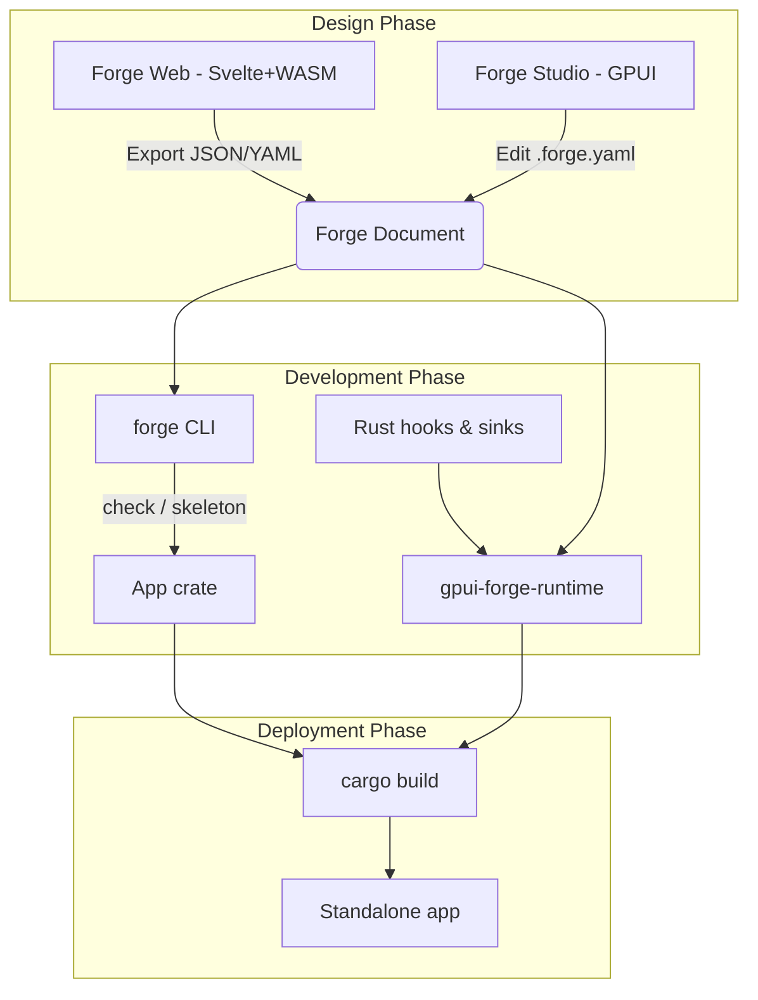

<div align="center">

  
  <h1>GPUI Forge</h1>

  <p>
    Visual prototyping and declarative UI development for
    <a href="https://www.gpui.rs/">GPUI</a> — design in YAML, render in Rust,
    ship a native binary.
  </p>

<!-- Badges -->
<p>
  <a href="https://github.com/skamansam/gpui-forge/graphs/contributors">
    
  </a>
  <a href="https://github.com/skamansam/gpui-forge/commits/main">
    
  </a>
  <a href="https://github.com/skamansam/gpui-forge/network/members">
    
  </a>
  <a href="https://github.com/skamansam/gpui-forge/stargazers">
    
  </a>
  <a href="https://github.com/skamansam/gpui-forge/issues/">
    
  </a>
</p>

<h4>
    <a href="https://gpui-forge.rudeboy.dev">Docs &amp; Live Editor</a>
  <span> · </span>
    <a href="docs/start/getting-started.md">Getting Started</a>
  <span> · </span>
    <a href="https://github.com/skamansam/gpui-forge/issues/">Report Bug</a>
  <span> · </span>
    <a href="https://github.com/skamansam/gpui-forge/issues/">Request Feature</a>
  </h4>
</div>

> *I have developed software since the 1990s, but I lack the time to build my ideas myself. So I enlisted the help of [Devin](https://devin.ai) and vibecoded this app into existence. If you notice a bug, please report it on the [gpui-forge issue tracker](https://github.com/skamansam/gpui-forge/issues). I will attend to it as soon as I can. Thank you — I hope this app helps you in some small way.*

<br />

<!-- Table of Contents -->
# :notebook_with_decorative_cover: Table of Contents

- [About the Project](#star2-about-the-project)
  * [Tech Stack](#space_invader-tech-stack)
  * [Features](#dart-features)
  * [Dogfooding](#dog-eating-our-own-dog-food)
  * [Base Component Systems](#jigsaw-base-component-systems)
  * [Architecture](#triangular_ruler-architecture-overview)
- [Getting Started](#toolbox-getting-started)
  * [Prerequisites](#bangbang-prerequisites)
  * [Installation](#gear-installation)
  * [Run Locally](#running-run-locally)
  * [Running Tests](#test_tube-running-tests)
  * [Deployment](#triangular_flag_on_post-deployment)
- [Usage](#eyes-usage)
- [Roadmap](#compass-roadmap)
- [Contributing](#wave-contributing)
- [FAQ](#grey_question-faq)
- [License](#warning-license)
- [Contact](#handshake-contact)
- [Acknowledgements](#gem-acknowledgements)

<!-- About the Project -->
## :star2: About the Project

Traditional GPUI development requires writing imperative Rust code for every
layout and element. **GPUI Forge** introduces a declarative workflow: design
your interface visually in a desktop or web editor — or author it directly as
YAML — wire logic through named hooks, and compile the result into a
high-performance native binary.

Six core pillars drive the project:

*   **Forge Schema (`forge-spec`)** — the YAML document model: saphyr loader
    (anchors, aliases, merge keys, source spans), canonical + preserving
    writers, catalog manifests, and validation. Shipped documents round-trip
    byte-for-byte.
*   **Forge Runtime (`gpui-forge-runtime`)** — renders any document through
    `ForgeView`: ~60 catalog elements on gpui-kit, state/binding (`{{ path }}`,
    `bind $path`), `on <event>` hook dispatch, dialogs, themes, drag &amp; drop,
    element picking. Built per-base via mutually exclusive `base-*` features.
*   **Forge CLI (`forge`)** — check, fmt, new, skeleton, build, preview,
    package, migrate, convert, schema, hooks, license, bases.
*   **Forge Studio (`forge-studio`)** — a self-hosted visual builder; its own
    UI is a Forge document. Project sidebar, palette, outline, inspector,
    two-way source pane, undo/redo, disk-watch reload, live per-base previews
    over IPC.
*   **Forge Web (`forge-web`)** — a Svelte editor/playground backed by
    `forge-web-canvas`, the runtime compiled to WebAssembly — web and native
    output match.
*   **Forge adapters (`forge-lib-*`)** — bridge third-party component
    libraries (video player, PDF, whiteboard, math, HIG, flow, and more) into
    documents via `use:`.

<!-- TechStack -->
### :space_invader: Tech Stack

<details>
  <summary>Core</summary>
  <ul>
    <li><a href="https://www.rust-lang.org/">Rust</a> (2024 edition workspace)</li>
    <li><a href="https://www.gpui.rs/">GPUI</a> — via per-base builds: <code>gpui-pre</code>, <code>gpui 0.2</code>, Bezel and adabraka forks</li>
    <li><a href="https://github.com/longbridge/gpui-component">gpui-kit / gpui-component</a> — the default component library</li>
    <li><a href="https://github.com/saphyr-rs/saphyr">saphyr</a> — YAML; <code>serde</code>/<code>serde_json</code> — JSON &amp; state</li>
  </ul>
</details>

<details>
  <summary>Non-GPUI bases</summary>
  <ul>
    <li><a href="https://ratatui.rs/">ratatui</a> — terminal UI</li>
    <li><a href="https://iced.rs/">iced</a> — Elm-style GUI on winit/wgpu</li>
  </ul>
</details>

<details>
<summary>Web</summary>
  <ul>
    <li><a href="https://svelte.dev/">Svelte</a> — docs site, editor, playground</li>
    <li><a href="https://webassembly.org/">WebAssembly</a> — the runtime compiled per WASM-capable base</li>
  </ul>
</details>

<details>
<summary>Tooling</summary>
  <ul>
    <li>Cargo workspaces — app crates generated by <code>forge build</code>/<code>forge skeleton</code> sit inside the checkout but are their own workspace</li>
    <li>JSON Schema generated from the serde model — drives editor <code>$schema</code> validation and the web TypeScript types</li>
  </ul>
</details>

<!-- Features -->
### :dart: Features

- **Declarative documents** — `*.forge.yaml` with anchors, merge keys,
  `state:` declarations, `use:` library imports, dialogs, and `on <event>`
  hooks. One fact per line for clean diffs.
- **Live visual editing** — Studio edits the document *and* its rendering in
  the same process: palette click/drag insertion, outline reparenting, an
  inspector with two-way source edits, undo/redo, and a disk watcher.
- **Project-aware Studio** — a `forge.Files` sidebar browses the project
  (bounded scan), with right-click *New document here*, *Reveal in file
  manager* and *Rename…*; opened files land in the Document tab. Window
  geometry persists across launches.
- **Real app output** — `forge build` scaffolds a native crate and compiles
  it (`--codegen` bakes the document into Rust); `forge skeleton` emits a
  *kept* multi-doc crate — `docs::DOCS` registry + `store::seed()` merged
  from every document's `state:` — as a launching pad you own.
- **Six bases, one format** — gpui-kit, gpui02 (vanilla GPUI 0.2), Bezel,
  adabraka-ui, plus non-GPUI ratatui and iced. Same document, per-base
  catalog, runtime adapter, preview host and generated-app template.
- **Adapter ecosystem** — `use:` pulls in adapter crates (Ely components,
  gpui-component, video player, PDF, whiteboard, math, HIG, flow, Base GPUI,
  and more); validation rejects base-incompatible libraries.
- **Web parity** — `forge-web` reuses the same runtime compiled to WASM, so
  the browser editor previews exactly what the app renders.
- **Crash-resistant debug builds** — every Forge binary (Studio, preview
  hosts, generated apps) re-execs under a 64 MB stack via
  `ensure_main_stack()`, because GPUI's recursive layout exceeds the default
  8 MB on deep documents.

<!-- Dogfooding -->
### :dog: Eating our own dog food

> **Forge Studio's entire UI is a Forge document.**
> [`crates/forge-studio/studio.forge.yaml`](crates/forge-studio/studio.forge.yaml)
> — ~850 lines of declarative YAML — is bundled into the binary and rendered
> at startup by the same `ForgeView` Studio hands to your documents.

Every panel you interact with is a runtime element doing its day job:

| What you see in Studio | The element | What it proves |
|---|---|---|
| Canvas | `forge.Preview` | embeds a live document render inside another document |
| Palette | `forge.Palette` | serves the element catalog with drag payloads |
| Structure outline | `forge.Outline` | renders a document's tree into state |
| Inspector | `forge.Inspector` | two-way edits typed props on the selected node |
| Project sidebar | `forge.Files` | lists `*.forge.yaml` with select/reveal/rename hooks |
| State tab | `forge.Vars` | introspects live document state |
| Showcase tabs | nested `forge.Preview` | other bases' demos render inside the shell doc |

`on click: save_document()` in the menu bar dispatches to Rust hooks
registered in `main.rs`; Preferences, New Project and Rename are `Dialog#`
blocks declared in the same file. The shell imports `use: forge: forge` like
any document would, passes the spec suite's validation tests, and — yes —
opens in Studio itself. If the format can't express Studio, the format gets
fixed.

<!-- Bases -->
### :jigsaw: Base Component Systems

A Rust app links exactly one `gpui`, so components built on different GPUI
versions or forks can't mix in one window. You pick a **base** (`base:` in the
document/`forge.toml`) which fixes the GPUI build; Forge only offers libraries
compatible with it. Within a base you can mix and match libraries freely.

| Base | GPUI build | Base library | Web/WASM |
|---|---|---|---|
| **gpui-kit** (default) | `gpui-pre =0.3.10` | [gpui-kit](https://github.com/longbridge/gpui-kit) | yes |
| **gpui02** — vanilla GPUI 0.2 | crates.io `gpui 0.2.x` | [guise](https://github.com/wess/guise) | no |
| **Bezel** | `bezel-gpui 0.3.x` (fork) | [Bezel](https://github.com/crabtalk/bezel) | yes |
| **adabraka-ui** | `adabraka-gpui` (fork) | [adabraka-ui](https://github.com/Augani/adabraka-ui) | no (nightly Rust) |

Non-GPUI bases share the same documents, loader, catalogs and validation —
each brings its own runtime adapter, style profile and preview host
(`forge-preview-<base>`, one shared JSON protocol):

| Base | Kind | Event model | Tracking |
|---|---|---|---|
| **ratatui** | Terminal UI — immediate-mode, redrawn per frame | `on <event>` fires while a node has focus | [#112](https://github.com/skamansam/gpui-forge/issues/112) |
| **iced** | Elm-style GUI on winit/wgpu | `on <event>` maps to a `Message` in `update()` | [#113](https://github.com/skamansam/gpui-forge/issues/113) |

* Each library ships a catalog manifest declaring the bases it supports.
* Changing base later is a migration: `forge migrate --base <id>`.
* Libraries pinned to raw Zed git revisions fit no base — tracked in
  [#83](https://github.com/skamansam/gpui-forge/issues/83).

<!-- Architecture -->
### :triangular_ruler: Architecture Overview



<!-- Getting Started -->
## :toolbox: Getting Started

<!-- Prerequisites -->
### :bangbang: Prerequisites

Rust stable (the workspace targets the 2024 edition). On Linux, GPUI also
needs system libraries (Ubuntu 24.04):

```bash
sudo apt install gcc g++ clang libfontconfig-dev libwayland-dev libwebkit2gtk-4.1-dev \
  libxkbcommon-x11-dev libx11-xcb-dev libssl-dev libzstd-dev libasound2-dev \
  vulkan-validationlayers libvulkan1
```

<!-- Installation -->
### :gear: Installation

```bash
git clone https://github.com/skamansam/gpui-forge.git
cd gpui-forge
cargo build --release -p forge-cli   # the `forge` binary: target/release/forge
```

<!-- Run Locally -->
### :running: Run Locally

```bash
cargo run -p forge-studio            # the visual builder
cargo run -p forge-cli -- studio     # same thing via the CLI
```

Create and preview your first app:

```bash
forge new my-app            # forge.toml + app.forge.yaml
cd my-app
forge skeleton              # kept app crate in ./app — yours to edit
forge build                 # scaffold + compile to a native binary
forge preview               # build + launch in one step
```

<!-- Running Tests -->
### :test_tube: Running Tests

```bash
cargo test --workspace             # default base: gpui-kit
cargo fmt --check && cargo clippy  # lint
```

<!-- Deployment -->
### :triangular_flag_on_post: Deployment

```bash
forge package            # --release build + AppDir/AppImage, .app, or NSIS
```

The docs site in `site/` deploys to GitHub Pages on every merge to `main`
(custom domain: [gpui-forge.rudeboy.dev](https://gpui-forge.rudeboy.dev)).

<!-- Usage -->
## :eyes: Usage

A document is declarative — state, imports and UI in one file:

```yaml
$schema: https://gpui-forge.rudeboy.dev/schema/0.1/gpui-kit.json
forge: "0.1"
base: gpui-kit
use:
  ely: ely-core

state:
  counter: 0
  user.name: string

root:
  VStack:
  style: {padding: 16px, gap: 8px}
  children:
    - Label: "Count: {{ counter }}"
    - Button:
      label: Increment
      on click: app.increment()
```

`forge skeleton` turns a project of these into an app crate: every document
becomes a `docs::DOCS` entry, every `state:` declaration merges into
`store::seed()`, and hooks dispatch to a `set_sinks` stub you fill in:

```rust
if let Some(doc) = docs::load(docs::PRIMARY) {
    view.set_document(doc, cx);
}
view.set_state(store::seed(), cx);
view.set_hook("app.increment", |args, view, cx| { /* your logic */ });
```

The full command surface is documented in
[docs/cli/forge-cli.md](docs/cli/forge-cli.md) — highlights:

| Command | Purpose |
|---|---|
| `forge check <doc>` | Parse + validate against the base catalog |
| `forge new <name> [--base]` | Project scaffold: `forge.toml` + `app.forge.yaml` |
| `forge skeleton` | Kept multi-doc app crate with merged `state:` store |
| `forge build [--codegen]` | Scaffold + compile a native binary |
| `forge preview <doc>` | Build + launch |
| `forge package` | Release build + OS bundle |
| `forge studio` | The visual builder |
| `forge migrate --base <id>` | Re-point a document at another base |

<!-- Roadmap -->
## :compass: Roadmap

- [x] **Foundation** — the `.forge.yaml` spec, document model, YAML
  anchors/merge keys, catalogs and validation ([#1](https://github.com/skamansam/gpui-forge/issues/1), [#12](https://github.com/skamansam/gpui-forge/issues/12))
- [x] **CLI** — check/fmt/convert/schema/new/build/preview/package/migrate,
  plus `forge skeleton` for kept multi-doc app crates ([#22](https://github.com/skamansam/gpui-forge/issues/22))
- [x] **Bases & adapters** — six registered bases with preview hosts and
  generated-app templates; `use:` adapter crates ([#70](https://github.com/skamansam/gpui-forge/issues/70), [#112](https://github.com/skamansam/gpui-forge/issues/112), [#113](https://github.com/skamansam/gpui-forge/issues/113))
- [x] **Web canvas** — Svelte editor backed by the WASM runtime ([#29](https://github.com/skamansam/gpui-forge/issues/29))
- [x] **Studio** — palette/outline/inspector editing, two-way source,
  undo/redo, project sidebar with file actions, persisted window geometry
  ([#41](https://github.com/skamansam/gpui-forge/issues/41), [#148](https://github.com/skamansam/gpui-forge/issues/148), [#150](https://github.com/skamansam/gpui-forge/issues/150))
- [ ] **Bridge** — the `#[forge_hook]` macro connecting declarative events to
  imperative Rust without boilerplate ([#52](https://github.com/skamansam/gpui-forge/issues/52))
- [ ] **Compiler polish** — packaging Studio itself and finalizing the
  standalone-app pipeline ([#61](https://github.com/skamansam/gpui-forge/issues/61))
- [ ] **Store sync** — two-way flow between a skeleton app's store and live
  `ForgeView` state (the stub is generated; the loop is app code today)

See the [issue tracker](https://github.com/skamansam/gpui-forge/issues) for
the full queue.

<!-- Contributing -->
## :wave: Contributing

<a href="https://github.com/skamansam/gpui-forge/graphs/contributors">
  
</a>

Contributions are welcome — this is an experimental project at the
intersection of systems programming and creative tooling. Especially wanted:
specification design, adapter crates for new component libraries, and hook
system ergonomics. Open an issue or PR on the
[issue tracker](https://github.com/skamansam/gpui-forge/issues).

<!-- FAQ -->
## :grey_question: FAQ

- Which base should I pick?

  + `gpui-kit` unless you have a reason: it has the most elements, every
    adapter, WASM support, and it's what Studio itself renders.

- Can I mix libraries from different bases?

  + No — a binary links one `gpui`. `forge check` and the base manifest's
    `libraries:` map reject incompatible `use:` imports. To switch,
    `forge migrate --base <id>`.

- Where does app logic live in a generated app?

  + In Rust, via hooks. `on <event>: name()` in the document becomes a
    `view.set_hook("name", ...)` / `set_sinks` call in the app —
    `forge skeleton` emits the dispatch stub to fill in.

- Why YAML and not just JSON?

  + Anchors, aliases and merge keys let documents share structure; comments
    survive; and one-fact-per-line diffs stay reviewable. YAML is a JSON
    superset, so `forge convert` is a serialize, not a translate.

- What's the difference between `forge build` and `forge skeleton`?

  + `build` scaffolds into `.forge-build/` (regenerated each run) and
    compiles a binary. `skeleton` writes a kept crate you edit and own —
    all documents embedded, a merged `store`, no compilation.

<!-- License -->
## :warning: License

No license file is distributed yet — treat the code as all-rights-reserved
until one lands. Adapter-linked libraries keep their own licenses
(`forge license <doc>` reports them; zorite-based widgets are GPL-3.0).

<!-- Contact -->
## :handshake: Contact

Samuel C Tyler — [@skamansam](https://github.com/skamansam) — skamansam@gmail.com

Project Link: [https://github.com/skamansam/gpui-forge](https://github.com/skamansam/gpui-forge)
Docs: [https://gpui-forge.rudeboy.dev](https://gpui-forge.rudeboy.dev)

<!-- Acknowledgments -->
## :gem: Acknowledgements

- [GPUI](https://www.gpui.rs/) and the [Zed](https://zed.dev/) team — the framework everything renders through
- [gpui-component / gpui-kit](https://github.com/longbridge/gpui-component) — the default component library
- [Workbench](https://github.com/workbenchdev/Workbench) — the inspiration for Studio
- [Devin](https://devin.ai) — the agent that wrote most of this code
- [saphyr](https://github.com/saphyr-rs/saphyr) — lossless-ish YAML for the document format
- Every adapter upstream: Ely GPUI Components, gpui-video-player, zorite, adabraka-ui, Bezel, ferrum-flow, rhythm-gpui, gpui-symbols
- [Awesome README Template](https://github.com/Louis3797/awesome-readme-template) — the structure of this file

### Implementation Note: Hooks
*The most difficult part of this architecture is the hook bridge. You cannot simply "inject" code at runtime in Rust — Forge uses a registry/event-dispatcher where documents name hooks (`on click: app.save()`), and the app maps those names to closures during `ForgeView` initialization (`set_hook`/`set_sinks`). `forge hooks <doc>` lists every handler a document requires.*
