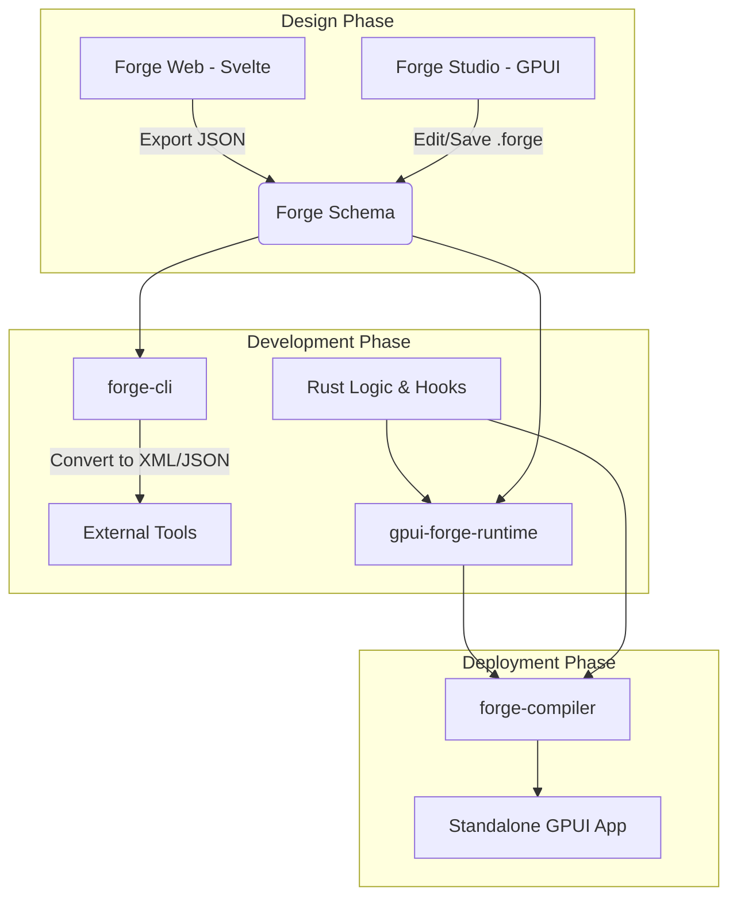

# GPUI Forge

**GPUI Forge** is an integrated ecosystem of tools designed to bring visual prototyping and rapid UI development to the [GPUI](https://www.gpui.rs/) framework. 

The goal of this project is to bridge the gap between high-level design and low-level Rust implementation, allowing developers to visually compose complex, high-performance user interfaces that can be seamlessly compiled into standalone, production-ready GPUI applications.

## 🚀 The Vision
Traditional GPUI development requires writing imperative Rust code for every layout and element. **GPUI Forge** introduces a declarative workflow: design your interface visually in a desktop or web-based editor, define logic via hooks, and compile the result into a high-performance native binary.

---

## 🛠 The Ecosystem

The project is comprised of six core pillars that work in tandem:

### 1. The Forge Schema (`forge-spec`)
A multi-format specification for defining GPUI element trees. To ensure interoperability, we support:
*   **ForgeDSL:** A custom, human-readable, indentation-based format optimized for Git diffs and ease of manual editing.
*   **JSON/XML:** Standardized formats for machine-to-machine communication between the Web Builder and the Rust Engine.

### 2. The Forge Converter (`forge-cli`)
A powerful command-line utility used to transform interface definitions between all supported formats (e.g., converting a JSON blob from the web editor into a `.forge` file for the desktop editor).

### 3. The Forge Runtime (`gpui-forge-runtime`)
The core Rust library that powers everything else. It is responsible for:
*   Parsing Forge definition files at runtime.
*   Mapping declarative elements (Buttons, Containers, Text) to native [gpui-kit](https://github.com/longbridge/gpui-kit) components.
*   **The Hook System:** A reactive bridge that allows developers to inject custom Rust logic and event handlers into the visually defined UI structure.

### 4. The Forge Studio (`forge-studio`)
The flagship desktop application built natively using **GPUI**. Inspired by [Workbench](https://github.com/workbenchdev/Workbench), it provides a professional IDE experience:
*   A visual canvas for dragging and dropping components.
*   Property inspectors for layout, styling, and padding.
*   Real-time preview of the UI logic.

### 5. The Forge Compiler (`forge-compiler`)
A build tool that takes a `.forge` definition and a set of Rust "hooks" and bundles them into a standalone, optimized GPUI application. This allows you to ship "demos" or "prototypes" as complete, single-binary executables.

### 6. Forge Web (`forge-web`)
A lightweight, Svelte-based web application that brings the power of visual design to the browser. The Svelte shell hosts a canvas that renders the real gpui-kit components via `gpui-forge-runtime` compiled to WebAssembly, so web and native output match. It serves as a collaborative design tool, allowing designers to iterate on UI layouts and export JSON definitions that can be immediately pulled into the Rust workflow.

---

## 📐 Architecture Overview

---

## 🛠 Tech Stack

*   **Language:** [Rust](https://www.rust-lang.org/) (Core engine, Runtime, Studio, Compiler)
*   **UI Framework:** [GPUI](https://www.gpui.rs/)
*   **Components:** [gpui-kit](https://github.com/longbridge/gpui-kit) (`gpui-component` / `gpui-base`)
*   **Web Frontend:** [Svelte](https://svelte.dev/) shell + gpui-kit canvas compiled to WebAssembly
*   **Serialization:** `serde` (JSON/XML/Custom)

## 🗺 Roadmap

- [ ] **Phase 1: The Foundation.** Define the `.forge` specification ([#1](https://github.com/skamansam/gpui-forge/issues/1)) and implement the `gpui-forge-runtime` ([#12](https://github.com/skamansam/gpui-forge/issues/12)).
- [ ] **Phase 2: The CLI.** Build `forge-cli` for format conversion ([#22](https://github.com/skamansam/gpui-forge/issues/22)).
- [ ] **Phase 3: The Web Canvas.** Create the Svelte editor for basic layout composition ([#29](https://github.com/skamansam/gpui-forge/issues/29)).
- [ ] **Phase 4: The Studio.** Develop the native GPUI desktop IDE (Forge Studio) ([#41](https://github.com/skamansam/gpui-forge/issues/41)).
- [ ] **Phase 5: The Bridge.** Finalize the Hook system to connect visual elements to imperative Rust code ([#52](https://github.com/skamansam/gpui-forge/issues/52)).
- [ ] **Phase 6: The Compiler.** Implement the bundling logic for standalone application generation ([#61](https://github.com/skamansam/gpui-forge/issues/61)).

---

## 🤝 Contributing
This is an experimental project at the intersection of systems programming and creative tooling. Contributions are welcome, especially regarding the specification design and the runtime performance of the hook system.

***

### Implementation Note: Hooks
*The most difficult part of this architecture will be **Point 3.1 (Hooks)**. To make this work, you cannot simply "inject" code at runtime in Rust. You will likely need to implement a **Trait-based Registry** or an **Event Dispatcher** where the visual builder defines `string_id`s for events, and your Rust application maps those IDs to actual function pointers or closures during the initialization phase of the `gpui-forge-runtime`.*
